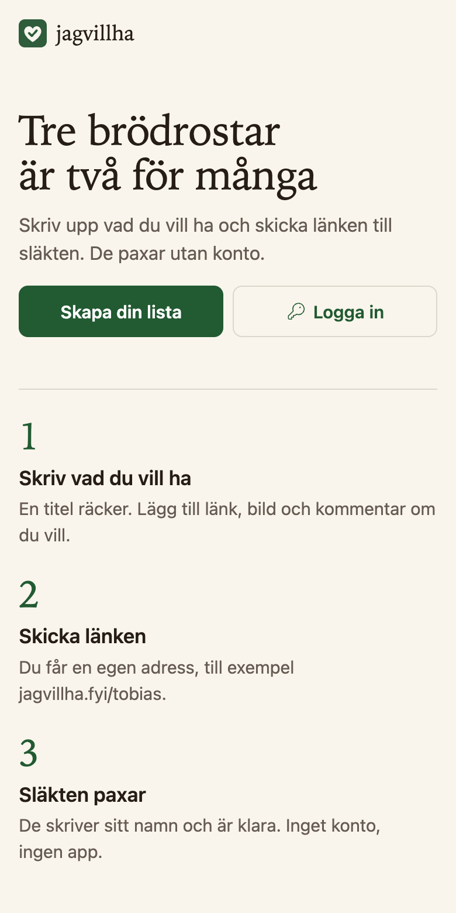
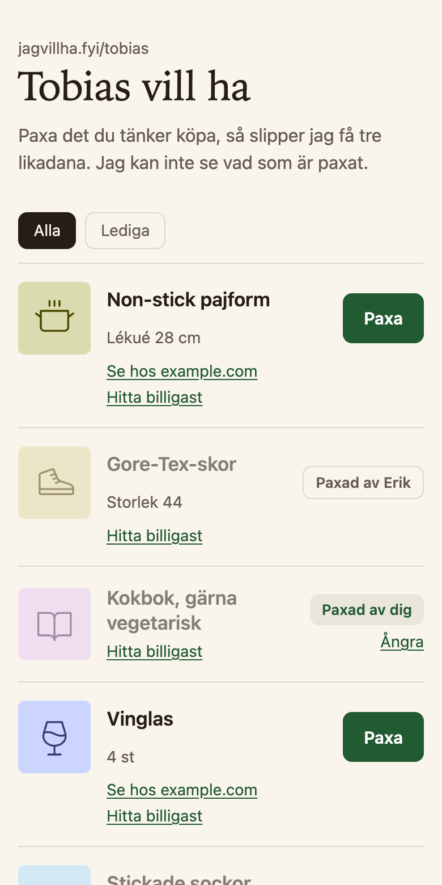
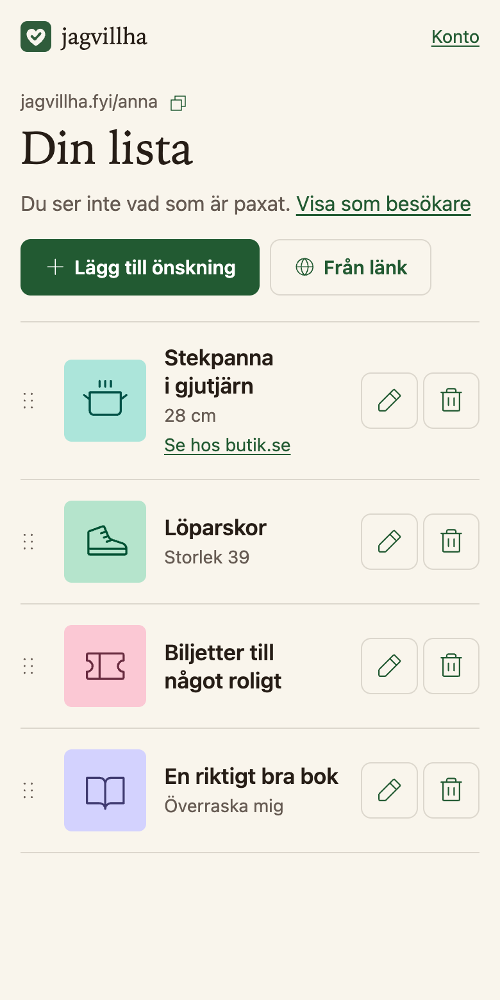

<p align="center">
  
</p>

<h1 align="center">Jag vill ha</h1>

<p align="center">
  <strong>Tre brödrostar är två för många.</strong><br>
  Wishlists where nobody buys the same thing twice, and the owner never finds out what is coming.
</p>

<p align="center">
  Live at <a href="https://jagvillha.fyi"><strong>jagvillha.fyi</strong></a>
</p>

<p align="center">
  
  
  
</p>

Write down what you want, send the link to the family. They reserve ("paxar")
what they plan to buy, without an account, and see what the others have taken.
The owner of the list sees none of it.

## Why it exists

My list has lived on [wishlistr](https://www.wishlistr.com). It works, but it
shows the owner who reserved what, which spoils the surprise, and it looks its
age. The bigger alternatives tend to want everyone to sign up, and pay for
themselves with ads.

This one is a hobby project and is going to stay one: free, no ads, no
affiliate links, no tracking, nothing sold. The interface is in Swedish.

## How it works

| | |
|---|---|
| **Önskelista** | One list per account, at `jagvillha.fyi/<name>`. A wish is a title, plus an optional link, comment and an icon or a picture. A picture can be moved and zoomed to choose which part is shown. |
| **Paxa** | A giver types their name and the wish is theirs. Other givers see "Paxad av Anna". A cookie on that device lets them undo it. |
| **Ägaren** | Signs in with a passkey. No password, and no email unless they add one for recovery. Can add a picture of themselves, and can delete the account with everything in it. |
| **Hitta billigast** | Each wish links to a search on Prisjakt and Google Shopping. Plain links, nothing fetched or tracked. |

The owner is kept out on the server, not in the interface. When the person
looking at a list is its owner, the reservation query is never run, and the
owner's own pages do not read the table at all. The owner can reset a wish
without being told whether it was reserved. One hole is known and accepted: an
owner who signs out and opens their own link sees what a giver sees.

## What is kept, and for how long

Nothing is meant to pile up.

- **Replacing or removing a picture, or deleting a wish,** removes the stored
  picture in the same request. So does a save that fails after the upload.
- **Deleting the account** removes the list, its wishes and reservations, every
  stored picture, the passkeys, the sessions and the user. The username is free
  again at once.
- **Once a week** a scheduled job removes login rows that have expired and any
  stored picture that no wish or list refers to. It leaves pictures less than a
  day old alone, and refuses to run if it would delete more than half of what is
  stored, since that points to a bug rather than to litter.

## Stack

- **[Void](https://void.cloud)** on **Cloudflare Workers**. File-based pages,
  server-rendered, with loaders and actions next to each page.
- **React as a template language only.** Every page is a Void island page with
  no islands, so no React reaches the browser. Forms are plain
  `<form method="post">` with a redirect afterwards.
- **D1** through Drizzle, with migrations in `db/migrations`.
- **R2** for pictures, served through the worker at `/bild/…` with `nosniff`.
  Pictures are cropped and downscaled in the browser before upload, to a square
  of at most 800 px for a wish and 400 px for a profile picture: a phone photo
  is several megabytes and the list shows it 64 px wide. Only the chosen square
  is stored, so there is nothing to keep in step afterwards.
- **Better Auth** with its passkey plugin. An account and its list are created
  only after the passkey is verified, so an abandoned sign-up leaves nothing
  behind. Email and password sign-up is switched off.
- **Phosphor** icons (light), as two self-hosted SVG sprites. No fonts, scripts
  or images are loaded from anywhere else.

Chrome and Safari only, deliberately. `<dialog>` opened with invoker commands,
`popover` with CSS anchor positioning, `:has()` for the filters and the icon
picker, `light-dark()`, cascade layers, CSS nesting and view transitions are
used directly, without fallbacks.

### The JavaScript there is

The public list and the landing page work with JavaScript turned off. What is
shipped is a handful of small hand-written files, about 600 lines together:

| File | Does | Without it |
|---|---|---|
| `passkey.js` | Sign-up, login, adding a passkey | Nothing: WebAuthn needs script |
| `list.js` | Drag to reorder, share or copy the link, adding from a link | Add, edit and delete still work |
| `picker.js` | Picture preview, drop a picture, choosing the part to keep, for wishes and the profile picture | Picking an icon or a file still works; the whole picture is uploaded |
| `forms.js` | Spinner and locked fields while a form is sent | The form is sent anyway |

## Run it locally

Needs Node 24.22+ or 26.12+ (Void's requirement).

```sh
npm install
npx void db seed --yes   # creates the local database with a sample list at /tobias
npm run dev              # http://localhost:5173
```

```sh
npm test                 # Vitest, pure functions only
npm run typecheck
```

Rules that matter live in plain functions under `src/` and are what the tests
cover: usernames, what a giver and an owner may see, form parsing, link safety
and the metadata parser. Tests run in Node with no Worker, so nothing that
needs a binding is tested there.

Mail sent in development lands in Void's local inbox; the dev server prints its
address on start.

## Deploy

A merge to main deploys. The `deploy` job in `.github/workflows/ci.yml` runs
`npx void deploy` once the checks have passed, with a Cloudflare token that
only main can read.

Void builds, applies migrations to D1 and publishes the worker. The Cloudflare
resources it created are recorded in `void.lock.json`. That file holds the
account id and the database id, which are identifiers rather than credentials.
The auth secret lives in Cloudflare, not in the repository.

## Where things are

```
pages/        one file per page, with its loader and action in *.server.ts
routes/       /bild (pictures) and two small JSON endpoints for adding from a link
crons/        the weekly clean-up
src/          rules, with their tests, and a few shared components
public/js/    the scripts
db/           schema, migrations, seed
auth.ts       passkey sign-up, sessions, recovery mail
```

## Known gaps

- **Fetching from a link is often refused.** Large shops drop automated
  requests. When it works, the name and picture are filled in for review; when
  it does not, the owner types them.
- **Tested in Chromium.** Safari and touch dragging have not been tried
  properly yet.
- **A picture uploaded with JavaScript off is stored as it is**, up to 5 MB,
  and cannot be cropped.
- **A crop can be made tighter later, not wider.** The original is never stored.
- **Nothing stops someone with the link from reserving everything.** The owner
  can reset a wish, but is not told that there is a reason to.
- **Undoing a reservation needs the same device.** Clear the cookies and only
  the owner's reset can free the wish.

## Licence and credits

[MIT](LICENSE). Icons from [Phosphor](https://phosphoricons.com), also MIT;
their licence is in `public/icons/PHOSPHOR-LICENSE`.
